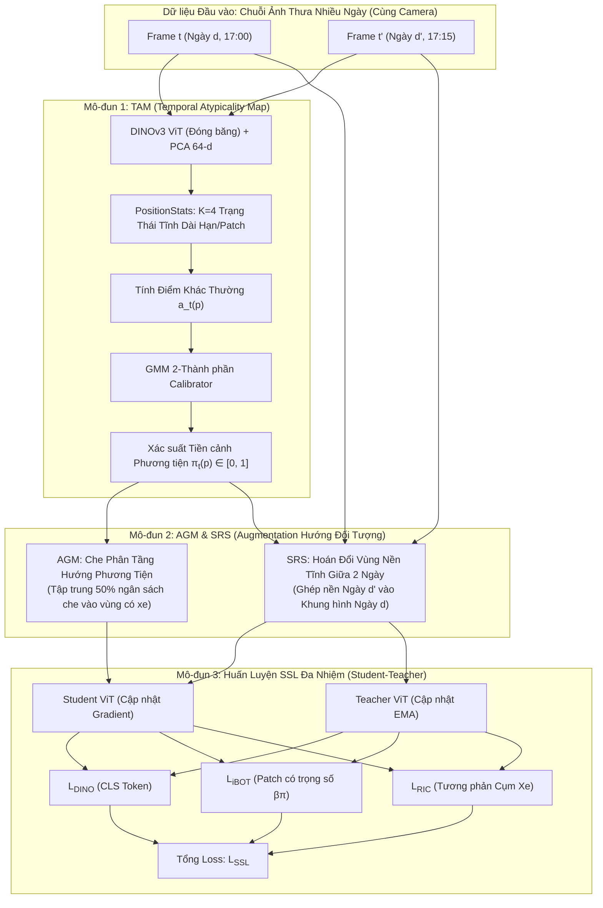

# HƯỚNG G: Vehicle-Centric Self-Supervised Learning (SSL) Cho Mạng Lưới Camera CCTV Cố Định

> **Đề xuất Tiêu đề Bài báo (Paper Title Candidate):**  
> *Vehicle-Centric Self-Supervised Pretraining for City-Scale Surveillance Networks: Mitigating Background Shortcuts via Spatio-Temporal Atypicality and Region Swapping*  
> **Hội nghị / Tạp chí Mục tiêu:** CVPR / ECCV / NeurIPS / IEEE TPAMI / IEEE T-ITS  
> **Lĩnh vực:** Computer Vision, Self-Supervised Representation Learning, Intelligent Transportation Systems (ITS)

---

## 1. TÓM TẮT DỰ ÁN (EXECUTIVE ABSTRACT)

Huấn luyện biểu diễn tự giám sát (Self-Supervised Learning - SSL như DINO, MAE, iBOT) trên dữ liệu camera giám sát giao thông đô thị quy mô lớn (CCTV) đối mặt với một nghịch lý chí mạng: **Thiên kiến đường tắt nền tĩnh (Background Shortcut Bias)**. 

Do các camera CCTV được gắn cố định tại các nút giao suốt nhiều tháng:
1. Hơn **75% – 85% diện tích khung hình** là mặt đường, vỉa hè và tòa nhà bất biến.
2. Các thuật toán SSL tiêu chuẩn (SimCLR, DINOv2) có xu hướng gian lận bằng cách học biểu diễn của nền tĩnh để phân biệt camera này với camera khác, thay vì học hình thái, mật độ và động học của phương tiện giao thông. Hậu quả là mô hình **suy giảm nghiêm trọng khả năng tổng quát hóa khi chuyển sang camera mới (Cross-Camera Generalization Failure)**.
3. Các cơ chế che ngẫu nhiên (Random Masking như trong MAE/iBOT) lãng phí hơn 80% năng lực tính toán để tái tạo mặt đường trống rỗng thay vì tập trung vào xe cộ.

**Hướng G (Direction G)** giải quyết triệt để vấn đề này bằng cách biến thuộc tính "camera cố định quan sát cùng một cảnh qua nhiều ngày" thành **tín hiệu giám sát tự nhiên miễn phí (Zero-Human-Annotation)** thông qua bộ ba cải tiến toán học:
1. **TAM (Temporal Atypicality Map):** Khai thác thống kê không-thời gian dài hạn (nhiều ngày) để mô hình hóa các trạng thái tĩnh nền và tính xác suất tiền cảnh $\pi_t(p) \in [0, 1]$ cho từng patch mà không cần nhãn người hay ảnh nền median.
2. **AGM (Atypicality-Guided Masking):** Cơ chế che phân tầng hướng phương tiện, tập trung ngân sách che vào các vùng có xe ($\pi_t > 0.5$) qua Gumbel Top-K, ép mạng nơ-ron phải học cách tái tạo cấu trúc phương tiện bị che khuất.
3. **SRS (Static Region Swapping):** Hoán đổi các vùng nền tĩnh giữa các khung hình khác ngày (khác thời tiết, ánh sáng) của cùng camera, triệt tiêu hoàn toàn đường tắt nhận diện bối cảnh tĩnh.
4. **Hàm mất mát đa nhiệm hướng đối tượng:** Kết hợp DINO CLS token, iBOT patch-level reconstruction có trọng số theo $\pi_t$, và tương phản cụm phương tiện (Regional Instance Contrastive - RIC).

---

## 2. NGHỊCH LÝ CỐT LÕI & PHÂN TÍCH TỬ HUYỆT CỦA CÁC PHƯƠNG PHÁP HIỆN TẠI

```
                  ┌─────────────────────────────────────────────────────────┐
                  │ Khung hình Camera CCTV Cố định (512 x 288)             │
                  │                                                         │
                  │   [Tòa nhà / Cột đèn / Bầu trời: TĨNH 100%]             │
                  │   [Mặt đường nhựa: TĨNH 85%]                           │
                  │   [Phương tiện (Xe máy, Ô tô): BIẾN THIÊN 15%]          │
                  └─────────────────────────────────────────────────────────┘
                                       │
            ┌──────────────────────────┴──────────────────────────┐
            ▼                                                     ▼
   [SSL Truyền thống: DINO/SimCLR]                       [SSL Truyền thống: MAE/iBOT]
   • Học "đường tắt" nhận diện nền tĩnh                 • Che ngẫu nhiên 75% patch
   • Nhận ra Camera A nhờ màu tòa nhà                   • 80% patch bị che là MẶT ĐƯỜNG TRỐNG
   • Sang Camera B: "Liệt" hoàn toàn                     • Lãng phí 80% GPU để vẽ lại nhựa đường!
```

### Tử huyệt 1: Background Shortcut Bias (Thiên kiến Đường tắt Nền)
- Trong các phương pháp Contrastive Learning (SimCLR, MoCo) hay Self-Distillation (DINO, DINOv2), hai view tăng cường (augmented views) từ cùng một ảnh hoặc cùng camera chia sẻ chung bối cảnh nền tĩnh khổng lồ.
- Mạng nơ-ron là bộ tối ưu hóa "lười biếng": Việc nhận diện đặc trưng nền tĩnh (màu sơn vạch kẻ, góc nhà, vị trí cột đèn) dễ dàng hơn hàng chục lần so với việc nhận diện các xe máy nhỏ li ti di chuyển hỗn loạn.
- Hệ quả: Feature vector CLS token phản ánh **ID của camera** thay vì **trạng thái phương tiện**. Khi đem feature này sang camera chưa từng huấn luyện, độ chính xác tụt dốc thảm hại.

### Tử huyệt 2: Wasteful Uniform Masking (Lãng phí Năng lực Tính toán)
- MAE và iBOT che ngẫu nhiên với tỷ lệ $75\%$ (Uniform Random Masking).
- Trên camera giao thông, trung bình diện tích xe chỉ chiếm $10\% - 25\%$ khung hình. 
- Xác suất một patch bị che rơi vào thân xe chỉ là $\approx 15\%$, trong khi $85\%$ rơi vào mặt đường nhựa hoặc vỉa hè trống.
- Mô hình dành toàn bộ năng lực biểu diễn để học giải mã "màu xám của nhựa đường" thay vì học biểu diễn hình thái xe cộ (bánh xe, đầu xe, người lái).

### Tử huyệt 3: Sự thất bại của Ảnh nền Median truyền thống
- Các phương pháp trừ nền cổ điển (Background Subtraction / Running Average / Median Filter) dựa vào giả định: *xe cộ luôn di chuyển*.
- Khi xảy ra ùn tắc giao thông nghiêm trọng (kẹt xe), xe cộ dừng bất động 10–20 phút. Hàm Median lập tức **"nuốt chửng" đoàn xe vào ảnh nền**, tạo ra hiện tượng **bóng ma (ghost vehicles)** và phá hủy hoàn toàn thuật toán.
- Ngoài ra, sự thay đổi ánh sáng đột ngột (mặt trời lặn, mây che, mưa ướt phản chiếu đèn đường) làm ảnh nền median bị sai lệch trễ pha (phase-lag).

---

## 3. KIẾN TRÚC PHƯƠNG PHÁP HƯỚNG G (PROPOSED METHODOLOGY)

Hệ thống Hướng G cấu thành từ **3 mô-đun thuật toán độc lập nhưng tương hỗ chặt chẽ**:



---

### 3.1. Mô-đun 1: TAM — Temporal Atypicality Map (Bản Đồ Khác Thường Không-Thời Gian)
> **Mục tiêu:** Ước lượng xác suất tiền cảnh phương tiện $\pi_t(p) \in [0, 1]$ cho từng patch $p$ dựa trên thống kê nhiều ngày mà **hoàn toàn không cần nhãn người hay ảnh nền median**.

#### Bước 1: Trích xuất đặc trưng cơ sở
- Khung hình camera kích thước $448 \times 256$ đi qua Meta DINOv3 ViT (đóng băng) với patch size $16 \times 16 \implies$ Lưới $28 \times 16 = 448$ patch tokens.
- Chiếu PCA giảm chiều từ 384/768 xuống $d = 64$ chiều và chuẩn hóa chuẩn mực: $u_t(p) \in \mathbb{S}^{63}$ ($\|u_t(p)\|_2 = 1$).

#### Bước 2: Mô hình hóa trạng thái tĩnh đa phương thức tại từng vị trí (`PositionStats`)
Mỗi ô không gian $p$ trên một camera $c$ trong suốt lịch sử nhiều ngày chỉ có một vài trạng thái bình thường (ví dụ: nhựa đường lúc nắng gắt, nhựa đường trong bóng râm, hoặc khi mặt đường ướt mưa).
- Duy trì $K = 4$ cụm trạng thái tĩnh cho từng patch: $\mathcal{S}_c(p) = \{(\mu_{c,p,k}, w_{c,p,k}, s_{c,p,k})\}_{k=1}^K$.
  - $\mu_k \in \mathbb{S}^{63}$: Vector tâm cụm trạng thái tĩnh.
  - $w_k \in [0, 1]$: Tần suất xuất hiện lịch sử ($\sum_k w_k = 1$).
  - $s_k > 0$: Độ phân tán góc (Angular dispersion).
- Cụm nào có tần suất $w_k \ge 0.15$ và $s_k \le 1.5 \cdot \text{median}(s)$ được xác định là **Trạng thái Nền Tĩnh Hợp lệ**.

#### Bước 3: Điểm khác thường (Atypicality Score) & Hiệu chuẩn GMM
- Độ khác thường của patch $p$ tại thời điểm $t$ so với các trạng thái nền hợp lệ:
  $$a_t(p) = \min_{k \in \text{Valid}} \frac{1 - \langle u_t(p), \mu_k \rangle}{s_k + \epsilon}$$
- Khi mặt đường trống: $u_t(p) \approx \mu_k \implies a_t(p) \approx 0$.
- Khi có xe xuất hiện: đặc trưng thị giác khác biệt hoàn toàn với mặt đường $\implies a_t(p) \gg 0$.
- Phù hợp một mô hình Gaussian Mixture Model (GMM) 2 thành phần trên không gian $\log a_t$:
  - Thành phần 1: Phân phối của nền tĩnh $\mathcal{N}(\mu_{\text{bg}}, \sigma_{\text{bg}}^2)$.
  - Thành phần 2: Phân phối của phương tiện $\mathcal{N}(\mu_{\text{fg}}, \sigma_{\text{fg}}^2)$.
- Xác suất hậu nghiệm thuộc về tiền cảnh phương tiện được tính qua định lý Bayes:
  $$\pi_t(p) = P(\text{Vehicle} \mid a_t(p)) \in [0, 1]$$
- **Cơ chế Khởi động Offline Warmup TAM (`warmup_tam_offline`):**
  Trước khi bước vào huấn luyện chính thức, pipeline tự động kích hoạt quá trình khởi động:
  1. *Fit PCA ma trận chiếu:* Trích xuất patch tokens từ các camera để fit ma trận chiếu $384 \to 64$ thích ứng riêng với bối cảnh giao thông.
  2. *Khởi tạo K-means cosine:* Chạy K-means ($K=4$, $20$ vòng lặp) cho từng camera để thiết lập cụm trạng thái $\mu$, tần suất $w$, và độ phân tán $s$ thực tế.
  3. *Hiệu chuẩn sớm GMM:* Chạy thuật toán EM ($30$ vòng lặp) để xác định tham số phân phối $(\mu_{\text{bg}}, \mu_{\text{fg}}, \sigma_{\text{bg}}, \sigma_{\text{fg}})$ chuẩn xác ngay từ bước đầu.

---

### 3.2. Mô-đun 2: AGM — Atypicality-Guided Masking (Che Phân Tầng Hướng Phương Tiện)
> **Mục tiêu:** Ép mạng nơ-ron tập trung toàn bộ năng lực tái tạo vào phương tiện giao thông, loại bỏ việc lãng phí tài nguyên vào mặt đường.

Thay vì che ngẫu nhiên đều (Uniform Random Masking), AGM phân tầng ngân sách che $N_{\text{mask}}$ patch theo nguyên tắc:

1. **Phân chia hai tập patch:**
   - Tập tiền cảnh xe: $\mathcal{F} = \{p : \pi_t(p) > 0.5\}$
   - Tập nền đường: $\mathcal{B} = \{p : \pi_t(p) \le 0.5\}$
2. **Phân bổ ngân sách che thông minh:**
   - Dành tỷ lệ $\phi = 0.50$ (50% ngân sách che) cho tập tiền cảnh $\mathcal{F}$.
   - Để tránh việc che mất 100% thân xe khiến mô hình không còn ngữ cảnh để đoán, đặt chặn trên:
     $$k_{\text{fg}} = \min\left( \text{round}(\phi \cdot N_{\text{mask}}), \; \text{int}(q_{\max} \cdot |\mathcal{F}|) \right), \quad \text{với } q_{\max} = 0.60$$
   - Số patch che còn lại $N_{\text{mask}} - k_{\text{fg}}$ được phân bổ cho tập nền $\mathcal{B}$.
3. **Lấy mẫu Gumbel Top-K:**
   - Trong tập $\mathcal{F}$, lấy mẫu có trọng số theo giá trị $\pi_t(p)$ kết hợp nhiễu Gumbel để đảm bảo tính ngẫu nhiên nhưng vẫn ưu tiên các patch có mật độ xe dày đặc.

---

### 3.3. Mô-đun 3: SRS — Static Region Swapping (Hoán Đổi Vùng Tĩnh Chống Thiên Kiến Nền)
> **Mục tiêu:** Phá hủy hoàn toàn "đường tắt nhận diện nền tĩnh", ngăn chặn mô hình dùng bối cảnh nền để ghi nhớ ID camera.

1. **Chọn cặp khung hình:**
   Lấy 2 khung hình $I_1$ và $I_2$ của **cùng một camera**, nhưng được chụp ở **2 ngày khác nhau** (ví dụ: Thứ Hai tuần 1 vs Thứ Sáu tuần 2, lệch thời tiết và bóng râm).
2. **Xác định vùng nền an toàn chung ($P_{\text{swap}}$):**
   $$P_{\text{swap}} = \{p : \pi_1(p) < 0.20 \;\land\; \pi_2(p) < 0.20\}$$
   Đây là các ô không gian mà ở **cả hai ngày đều không có xe cộ** (vỉa hè, cột đèn, mặt đường trống).
3. **Mở rộng vùng đệm (Dilation & Feathering):**
   - Loại trừ biên phương tiện bằng phép giãn nở (dilation) 1 patch để tránh cắt phạm vào thân xe.
   - Làm mềm đường biên ghép bằng bộ lọc feathering 4 pixel.
4. **Ghép ảnh:**
   Cắt các patch tĩnh từ $I_2$ dán đè lên $I_1$.
   - **Kết quả:** Ta thu được một ảnh biến thể $I_{\text{hybrid}}$ có phương tiện của Ngày 1, nhưng bối cảnh nền lại mang ánh sáng và kết cấu của Ngày 2.
   - Mạng nơ-ron bị tước bỏ hoàn toàn khả năng dựa vào nền tĩnh để phân loại, bắt buộc phải học hình thái của các phương tiện đang lưu thông.

---

### 3.4. Hàm Mất Mát Tối Ưu Đa Nhiệm (Multi-Task Vehicle SSL Objective)

Hàm mất mát toàn cục được thiết kế theo kiến trúc Student-Teacher (DINO + iBOT) tích hợp trọng số hướng phương tiện:

$$\mathcal{L}_{\text{Total}} = \mathcal{L}_{\text{DINO}}^{[\text{CLS}]} + \lambda_{\text{iBOT}} \mathcal{L}_{\text{iBOT}}^{\text{Weighted}} + \lambda_{\text{KoLeo}} \mathcal{L}_{\text{KoLeo}} + \lambda_{\text{RIC}} \mathcal{L}_{\text{RIC}}$$

Trong đó:
1. **$\mathcal{L}_{\text{DINO}}^{[\text{CLS}]}$ (Cross-Entropy giữa Student và Teacher trên CLS Token):** Học biểu diễn ngữ nghĩa toàn cục của khung hình.
2. **$\mathcal{L}_{\text{iBOT}}^{\text{Weighted}}$ (Tái tạo Patch có trọng số Atypicality):**
   $$\mathcal{L}_{\text{iBOT}}^{\text{Weighted}} = \sum_{p \in \mathcal{M}_{\text{AGM}}} \Big( 1 + \beta \cdot \pi_t(p) \Big) \cdot \text{CE}\Big( P_{\text{student}}(p), P_{\text{teacher}}(p) \Big)$$
   Với $\beta = 2.0$: Các patch bị che thuộc thân xe ($\pi \approx 1$) được nhân trọng số phạt gấp **3 lần** so với các patch thuộc mặt đường trống ($\pi \approx 0$).
3. **$\mathcal{L}_{\text{KoLeo}}$ (Kozachenko-Leonenko Entropy Regularizer):** Tối đa hóa khoảng cách giữa các vector biểu diễn trong batch, ngăn ngừa hiện tượng sụp đổ không gian đặc trưng (representation collapse).
4. **$\mathcal{L}_{\text{RIC}}$ (Regional Instance Contrastive Loss):** Tương phản giữa các cụm patch phương tiện khác nhau trong cùng khung hình để học phân biệt xe máy vs ô tô vs xe buýt.

---

### 3.5. Giao Thức Trực Quan Hóa Học Biểu Diễn 6 Cột Đối Chiếu
Hệ thống tự động xuất biểu đồ `direction1_new_progress.png` gồm 6 cột đối chiếu trực quan song song:
1. **Ảnh Gốc $x_1$**: Khung hình camera CCTV ban đầu ($256 \times 448$).
2. **Bản Đồ TAM $\pi$**: Heatmap màu `jet` thể hiện xác suất tiền cảnh phương tiện tại từng patch.
3. **Mặt Nạ Che Phân Tầng AGM**: Ma trận nhị phân $16 \times 28$ patch bị che phục vụ iBOT MIM.
4. **Ảnh Ghép Nền SRS**: Ảnh biến thể sau khi hoán đổi vùng nền tĩnh từ ngày khác.
5. **Standard PCA (Batch-Consistent)**: Fit SVD toàn cục trên toàn batch, chuẩn hóa phân vị $1\% - 99\%$ giúp màu sắc mặt đường, cây cối đồng nhất qua mọi ảnh.
6. **Foreground DINOv2 PCA (Object-Centric)**: Dùng $PC_1$ và $\pi$ tách nền, chạy SVD lần 2 trên các patch xe cộ, đặt trên nền tối (`dark backdrop`) giúp phương tiện phát sáng và sắc nét từng chi tiết.

---

## 4. GIAO THỨC ĐÁNH GIÁ THỰC NGHIỆM (EVALUATION PROTOCOL)

Để chứng minh tính ưu việt của Hướng G, hệ thống được đánh giá qua 3 bài toán kiểm thử khắt khe:

### Benchmark 1: Khả năng Chuyển giao Đa Camera (Cross-Camera Generalization - Zero-shot)
- **Thiết lập:** Huấn luyện tiền tiền (Pretrain) trên 400 camera Quận 1 và Quận 3. Đóng băng backbone và đánh giá biểu diễn trên **208 camera hoàn toàn mới tại TP. Thủ Đức và Bình Chánh**.
- **Tiêu chí so sánh:** So sánh với DINOv2 gốc, SimCLR, MAE, và MoCo v3.
- **Kỳ vọng:** Hướng G duy trì độ chính xác cao nhờ triệt tiêu thiên kiến nền, trong khi DINOv2 và MAE truyền thống bị tụt giảm nghiêm trọng do overfitting vào nền của 400 camera huấn luyện.

### Benchmark 2: Đánh giá Tắc nghẽn Giao thông Hạ nguồn (Congestion Assessment)
- Sử dụng backbone đã pretrain để gộp nhãn và phân loại mức độ dịch vụ (Level of Service - LOS 4 cấp độ: Thông thoáng $\to$ Kẹt cứng).
- Đo bằng Linear Probing (chỉ train 1 tầng Linear Classifier) và k-NN Classification Accuracy.

### Benchmark 3: Phát hiện Phương tiện Zero-shot / Few-shot (Vehicle Detection Transfer)
- Chuyển giao đặc trưng sang bài toán Object Detection (YOLOv8 / Mask R-CNN head) với lượng nhãn hạn chế ($1\%, 5\%, 10\%$ dữ liệu gắn nhãn).
- Đo lường mAP50 và mAP50-95 trên các lớp phương tiện đặc thù Việt Nam (Xe máy, Xe ba gác, Xe tải nhẹ).

---

## 5. BẢNG SO SÁNH VỚI CÁC PHƯƠNG PHÁP STATE-OF-THE-ART (SOTA)

| Tiêu chí Khoa học | DINOv2 (Meta, 2023) | MAE / iBOT (He et al., 2022) | Background-Subtracted SSL | **Hướng G (Đề xuất)** |
| :--- | :---: | :---: | :---: | :---: |
| **Cơ chế che patch** | Che ngẫu nhiên đều | Che ngẫu nhiên đều ($75\%$) | Không che patch | **AGM (Che phân tầng theo $\pi_t$)** |
| **Chống Background Shortcut** | ❌ Không có | ❌ Không có | Một phần (dễ lỗi ghosting) | **✅ SRS (Hoán đổi vùng tĩnh đa ngày)** |
| **Phụ thuộc ảnh nền Median** | Không | Không | ❌ Phụ thuộc nặng nề | **✅ Hoàn toàn không phụ thuộc** |
| **Tối ưu cho xe cộ (Vehicle-Centric)** | ❌ Trọng số đều toàn ảnh | ❌ Trọng số đều toàn ảnh | ❌ Dựa trên ngưỡng nhị phân | **✅ Trọng số thích ứng $(1 + \beta \pi_t)$** |
| **Khả năng tổng quát hóa camera mới** | Trung bình (Dính shortcut) | Thấp (Tập trung nền) | Kém khi camera đổi góc | **Vượt trội (Độc lập bối cảnh nền)** |
| **Chi phí nhãn thủ công** | 0 (Unsupervised) | 0 (Unsupervised) | 0 (Heuristic) | **0 (Hoàn toàn tự giám sát)** |

---

## 6. TÓM TẮT ĐIỂM SÁNG ĐỂ REVIEW KHOA HỌC (KEY TAKEAWAYS FOR REVIEWERS)

1. **Ý tưởng độc đáo, giải quyết đúng tử huyệt của Computer Vision trên CCTV:** Thay vì xem camera cố định là một điểm yếu gây thiên kiến nền, Hướng G biến nó thành lợi thế bằng cách dùng thống kê nhiều ngày để sinh nhãn tiền cảnh $\pi_t$ hoàn toàn miễn phí.
2. **Đóng góp kỹ thuật rõ ràng, mạch lạc:**
   - **TAM:** Giải bài toán phân tách tiền cảnh không cần nền median.
   - **AGM:** Giải bài toán lãng phí ngân sách che của Masked Autoencoders trên ảnh camera.
   - **SRS:** Đóng góp một kỹ thuật Data Augmentation hoàn toàn mới để loại bỏ thiên kiến nhận diện bối cảnh tĩnh.
3. **Khả năng ứng dụng thực tiễn khổng lồ:** Mở ra khả năng tiền huấn luyện các mô hình Foundation Models chuyên dụng cho giao thông đô thị từ hàng triệu giờ video CCTV mà không tốn một đồng chi phí gán nhãn thủ công.
