# Đặc Tả Toán Học & Lý Thuyết Nền Tảng: Context-Aware Markov Weak Supervision (CAM-WS)

> **Cấp độ học thuật:** Chuyên khảo Toán học & Thuật toán (Chuẩn mực IEEE TPAMI / NeurIPS / JMLR)  
> **Chủ đề:** Khung lý thuyết Gộp nhãn yếu dựa trên Mô hình Đồ thị Xác suất (Probabilistic Graphical Models), Động học Markov Rời rạc, Hàm Hợp lý Biên (Marginal Likelihood), Thuật toán Forward-Backward và Bổ đề Hội tụ EM.

---

## MỤC LỤC TOÁN HỌC CHUYÊN SÂU

1. [Định Cấu Hình Mô Hình Đồ Thị Sinh (Generative Graphical Model)](#1-định-cấu-hình-mô-hình-đồ-thị-sinh-generative-graphical-model)
   - [1.1. Không gian Xác suất & Không gian Trạng thái](#11-không-gian-xác-suất--không-gian-trạng-thái)
   - [1.2. Đồ thị Hướng Không Chu trình (DAG) & Tính Độc lập Có điều kiện (d-separation)](#12-đồ-thị-hướng-không-chu-trình-dag--tính-độc-lập-có-điều-kiện-d-separation)
   - [1.3. Phân rã Phân phối Đồng thời Toàn cục (Joint Distribution Factorization)](#13-phân-rã-phân-phối-đồng-thời-toàn-cục-joint-distribution-factorization)
2. [Động Học Markov Cấp 1 & Tính Chất Phổ Của Ma Trận Chuyển Trạng Thái](#2-động-học-markov-cấp-1--tính-chất-phổ-của-ma-trận-chuyển-trạng-thái)
   - [2.1. Toán tử Chuyển trạng thái & Định lý Perron-Frobenius](#21-toán-tử-chuyển-trạng-thái--định-lý-perron-frobenius)
   - [2.2. Khoảng phổ (Spectral Gap) & Thời gian Hòa trộn (Mixing Time)](#22-khoảng-phổ-spectral-gap--thời-gian-hòa-trộn-mixing-time)
   - [2.3. Ràng buộc Quán tính Vật lý Đô thị (Temporal Low-Pass Regularization)](#23-ràng-buộc-quán-tính-vật-lý-đô-thị-temporal-low-pass-regularization)
3. [Lý Thuyết Hàm Hợp Lý (Likelihood Theory) & Độ Phức Tạp Tính Toán](#3-lý-thuyết-hàm-hợp-lý-likelihood-theory--độ-phức-tạp-tính-toán)
   - [3.1. Complete-Data Log-Likelihood vs. Incomplete-Data Marginal Log-Likelihood](#31-complete-data-log-likelihood-vs-incomplete-data-marginal-log-likelihood)
   - [3.2. Định lý về Sự Bất khả Thi khi Cực đại hóa Trực tiếp (Intractability Theorem)](#32-định-lý-về-sự-bất-khả-thi-khi-cực-đại-hóa-trực-tiếp-intractability-theorem)
4. [Suy Diễn Biến Phân & Chứng Minh Hội Tụ Đơn Điệu Của Thuật Toán EM](#4-suy-diễn-biến-phân--chứng-minh-hội-tụ-đơn-điệu-của-thuật-toán-em)
   - [4.1. Phân rã Năng lượng Tự do Biến phân (Variational Free Energy Decomposition)](#41-phân-rã-năng-lượng-tự-do-biến-phân-variational-free-energy-decomposition)
   - [4.2. Bổ đề Tối ưu Bước E qua Khoảng cách Kullback-Leibler](#42-bổ-đề-tối-ưu-bước-e-qua-khoảng-cách-kullback-leibler)
   - [4.3. Chứng minh Định lý Hội tụ Đơn điệu (Monotonic Convergence Theorem)](#43-chứng-minh-định-lý-hội-tụ-đơn-điệu-monotonic-convergence-theorem)
   - [4.4. Tính Khả Định Danh Mô Hình (Model Identifiability & Kruskal's Theorem)](#44-tính-khả-định-danh-mô-hình-model-identifiability--kruskals-theorem)
5. [Thuật Toán Forward-Backward: Thiết Lập Giải Tích & Log-Sum-Exp Stabilization](#5-thuật-toán-forward-backward-thiết-lập-giải-tích--log-sum-exp-stabilization)
   - [5.1. Hệ Phương Trình Chapman-Kolmogorov cho Biến Forward-Backward](#51-hệ-phương-trình-chapman-kolmogorov-cho-biến-forward-backward)
   - [5.2. Chặn Sai Số Số Học của Toán Tử Log-Sum-Exp (LSE Operator Error Bounds)](#52-chặn-sai-số-số-học-của-toán-tử-log-sum-exp-lse-operator-error-bounds)
   - [5.3. Suy Xuất Chính Xác của Phân Phối Hậu Nghiệm Mềm $\gamma_t(k)$ và $\xi_t(i, j)$](#53-suy-xuất-chính-xác-của-phân-phối-hậu-nghiệm-mềm-gamma_tk-và-xi_ti-j)
6. [Tối Ưu Hóa Bước M Bằng Nhân Tử Lagrange & Tiên Nghiệm Dirichlet](#6-tối-ưu-hóa-bước-m-bằng-nhân-tử-lagrange--tiên-nghiệm-dirichlet)
   - [6.1. Thiết lập Bài toán Tối ưu Ràng buộc Có điều kiện](#61-thiết-lập-bài-toán-tối-ưu-ràng-buộc-có-điều-kiện)
   - [6.2. Suy dẫn Giải tích Đóng (Closed-Form Analytical Derivation)](#62-suy-dẫn-giải-tích-đóng-closed-form-analytical-derivation)
   - [6.3. Diễn giải Bayes: Làm trơn Laplace tương đương Ước lượng MAP dưới Dirichlet Prior](#63-diễn-giải-bayes-làm-trơn-laplace-tương-đương-ước-lượng-map-dưới-dirichlet-prior)
7. [Chưng Cất Mô Hình End-Model: Causal Information Distillation](#7-chưng-cất-mô-hình-end-model-causal-information-distillation)
   - [7.1. Tối thiểu hóa Phân kỳ KL giữa End-Model và Hậu nghiệm HMM](#71-tối-thiểu-hóa-phân-kỳ-kl-giữa-end-model-và-hậu-nghiệm-hmm)
   - [7.2. Tính Nhân Quả (Causality) & Phân tích Gradient Chặn Lọc Tự Tin](#72-tính-nhân-quả-causality--phân-tích-gradient-chặn-lọc-tự-tin)
8. [Đối Chiếu Toán Học - Mã Nguồn Chi Tiết Từng Dòng (`label_model.py`)](#8-đối-chiếu-toán-học---mã-nguồn-chi-tiết-từng-dòng-label_modelpy)

---

## 1. Định Cấu Hình Mô Hình Đồ Thị Sinh (Generative Graphical Model)

### 1.1. Không gian Xác suất & Không gian Trạng thái
Xét không gian xác suất nền tảng $(\Omega, \mathcal{F}, \mathbb{P})$. Chuỗi thời gian quan sát có độ dài $T \in \mathbb{N}^*$.
- **Không gian trạng thái ẩn (Latent State Space):**  
  $\mathcal{Y} = \{0, 1, \dots, K-1\}$ với $K = 4$ tương ứng với 4 cấp độ lưu thông:
  - $0$: Thông thoáng (Free-flow)
  - $1$: Đông nhẹ (Moderate)
  - $2$: Ùn ứ (Slow/Heavy)
  - $3$: Kẹt cứng nghiêm trọng (Jammed)
  Chuỗi trạng thái ẩn được biểu diễn bằng vector ngẫu nhiên $\mathbf{Y}_{1:T} = (Y_1, Y_2, \dots, Y_T) \in \mathcal{Y}^T$.

- **Không gian quan sát nhãn yếu (Weak Label Observations):**  
  Hệ thống gồm $J$ hàm gán nhãn (Labeling Functions - LFs), ở đây $J = 5$.  
  Tại mỗi thời điểm $t$, đầu ra của LF thứ $j$ là biến ngẫu nhiên $\Lambda_{t,j} \in \mathcal{L} = \{-1, 0, 1, \dots, K-1\}$, trong đó giá trị $-1$ biểu thị quyết định **Abstain (Bỏ phiếu trắng do không đủ độ tin cậy)**.  
  Đặt $\boldsymbol{\Lambda}_t = (\Lambda_{t,1}, \Lambda_{t,2}, \dots, \Lambda_{t,J})^\top \in \mathcal{L}^J$ và toàn bộ chuỗi quan sát là ma trận $\boldsymbol{\Lambda}_{1:T} \in \mathcal{L}^{T \times J}$.

- **Không gian ngữ cảnh ngoại cảnh (Context Space):**  
  Biến ngữ cảnh $C_t \in \mathcal{C} = \{0, 1, \dots, C-1\}$ với $C = 54$, mô tả các lát cắt môi trường vật lý (ánh sáng, khung giờ, loại đường, mật độ nền). Chuỗi ngữ cảnh ký hiệu là $\mathbf{C}_{1:T} = (C_1, C_2, \dots, C_T) \in \mathcal{C}^T$.

---

### 1.2. Đồ thị Hướng Không Chu trình (DAG) & Tính Độc lập Có điều kiện (d-separation)

Cấu trúc phụ thuộc nhân quả giữa các biến ngẫu nhiên được hình thức hóa qua Đồ thị có hướng không chu trình (Directed Acyclic Graph - DAG) dưới đây:

```mermaid
graph LR
    subgraph Time_t_minus_1 ["Thời điểm t - 1"]
        Y_prev((Y<sub>t-1</sub>))
        C_prev[C<sub>t-1</sub>]
        L_prev[&#923;<sub>t-1, 1:J</sub>]
        Y_prev --> L_prev
        C_prev --> L_prev
    end

    subgraph Time_t ["Thời điểm t"]
        Y_curr((Y<sub>t</sub>))
        C_curr[C<sub>t</sub>]
        L_curr[&#923;<sub>t, 1:J</sub>]
        Y_curr --> L_curr
        C_curr --> L_curr
    end

    subgraph Time_t_plus_1 ["Thời điểm t + 1"]
        Y_next((Y<sub>t+1</sub>))
        C_next[C<sub>t+1</sub>]
        L_next[&#923;<sub>t+1, 1:J</sub>]
        Y_next --> L_next
        C_next --> L_next
    end

    Y_prev -->|Ma trận A| Y_curr
    Y_curr -->|Ma trận A| Y_next
```

Dựa trên tiêu chuẩn **d-separation** của Judea Pearl, mô hình thỏa mãn 3 tiên đề độc lập có điều kiện sống còn:

1. **Tính chất Markov Cấp 1 của Trạng thái Ẩn:**
   $$Y_t \perp Y_{1:t-2} \mid Y_{t-1}, \quad \forall t \ge 3$$
   Nghĩa là: Quá khứ $Y_{1:t-2}$ và hiện tại $Y_t$ độc lập có điều kiện khi đã biết trạng thái liền kề $Y_{t-1}$.

2. **Tính Độc lập Điều kiện của Đầu ra Quan sát (Conditional Independence of Emissions):**
   $$\Lambda_{t,j} \perp \Lambda_{t,j'} \mid (Y_t, C_t), \quad \forall j \neq j'$$
   Nghĩa là: Khi đã cố định mức độ kẹt xe thực tế $Y_t$ và ngữ cảnh môi trường $C_t$, sai số của các hàm nhãn yếu (như YOLO và Background Subtraction) là độc lập với nhau.

3. **Tính Độc lập của Quan sát qua Thời gian (Temporally Independent Emissions):**
   $$\boldsymbol{\Lambda}_t \perp \boldsymbol{\Lambda}_{\tau} \mid (Y_t, C_t), \quad \forall \tau \neq t$$
   Toàn bộ tương quan thời gian giữa các quan sát được hấp thụ trọn vẹn thông qua chuỗi trạng thái ẩn $Y_t$.

---

### 1.3. Phân rã Phân phối Đồng thời Toàn cục (Joint Distribution Factorization)

Từ cấu trúc đồ thị trên và quy tắc dây chuyền xác suất (chain rule), phân phối xác suất đồng thời đầy đủ của toàn bộ hệ thống phân rã một cách chặt chẽ thành tích của 3 toán tử xác suất:

$$\mathbb{P}(\mathbf{Y}_{1:T}, \boldsymbol{\Lambda}_{1:T} \mid \mathbf{C}_{1:T}, \theta) = \mathbb{P}(Y_1 \mid \boldsymbol{\pi}) \prod_{t=2}^{T} \mathbb{P}(Y_t \mid Y_{t-1}, \mathbf{A}) \prod_{t=1}^{T} \prod_{j=1}^{J} \mathbb{P}(\Lambda_{t,j} \mid Y_t, C_t, \mathbf{E})$$

Trong đó:
- $\boldsymbol{\pi} \in \Delta^{K-1}$: Phân phối tiên nghiệm ban đầu, $\pi_k = \mathbb{P}(Y_1 = k)$.
- $\mathbf{A} \in \mathbb{R}^{K \times K}$: Ma trận chuyển trạng thái Markov, $A_{ik} = \mathbb{P}(Y_t = k \mid Y_{t-1} = i)$.
- $\mathbf{E} \in \mathbb{R}^{J \times C \times K \times (K+1)}$: Tensor ma trận nhầm lẫn / phát xạ (Emission tensor):
  $$E_{j, c, k, v} = \mathbb{P}(\Lambda_{t,j} = v \mid Y_t = k, C_t = c)$$

---

## 2. Động Học Markov Cấp 1 & Tính Chất Phổ Của Ma Trận Chuyển Trạng Thái

### 2.1. Toán tử Chuyển trạng thái & Định lý Perron-Frobenius

Ma trận chuyển tiếp $\mathbf{A}$ là một ma trận ngẫu nhiên hàng (row-stochastic matrix):
$$\sum_{j=0}^{K-1} A_{ij} = 1, \quad \forall i \in \mathcal{Y}; \quad A_{ij} \ge 0, \quad \forall i, j \in \mathcal{Y}$$

Theo **Định lý Perron-Frobenius** áp dụng cho ma trận ngẫu nhiên bất khả quy (irreducible) và phi chu kỳ (aperiodic):
1. Bán kính phổ của $\mathbf{A}$ bằng đúng $1$:
   $$\rho(\mathbf{A}) = \max_{i} |\lambda_i(\mathbf{A})| = 1$$
2. Giá trị riêng $\lambda_1 = 1$ là đơn (multiplicity = 1), và vector riêng bên trái tương ứng $\boldsymbol{\pi}_\infty \in \Delta^{K-1}$ thỏa mãn:
   $$\boldsymbol{\pi}_\infty \mathbf{A} = \boldsymbol{\pi}_\infty, \quad \sum_{k=0}^{K-1} \pi_{\infty, k} = 1$$
   $\boldsymbol{\pi}_\infty$ chính là **Phân phối dừng (Stationary Distribution)** của chuỗi Markov giao thông.

---

### 2.2. Khoảng phổ (Spectral Gap) & Thời gian Hòa trộn (Mixing Time)

Sắp xếp phổ giá trị riêng của ma trận $\mathbf{A}$:
$$1 = \lambda_1 > |\lambda_2| \ge |\lambda_3| \ge \dots \ge |\lambda_K| \ge 0$$

Khoảng phổ (Spectral Gap) được định nghĩa là:
$$\gamma_{\text{spectral}} = 1 - |\lambda_2|$$

Theo lý thuyết Markov Chain Mixing (Levin & Peres, 2017), khoảng cách biến thiên toàn phần (Total Variation Distance) giữa phân phối trạng thái tại bước $t$ và phân phối dừng $\boldsymbol{\pi}_\infty$ bị chặn trên bởi:
$$\|\boldsymbol{\pi}_t - \boldsymbol{\pi}_\infty\|_{\text{TV}} \le \frac{1}{2} \sqrt{\frac{1 - \pi_{\infty, \min}}{\pi_{\infty, \min}}} \cdot |\lambda_2|^t$$

Thời gian hòa trộn $\tau_{\text{mix}}(\epsilon)$ biểu thị thời gian để chuỗi quên đi trạng thái xuất phát ban đầu:
$$\tau_{\text{mix}}(\epsilon) \approx \frac{1}{\gamma_{\text{spectral}}} \log\left( \frac{1}{\epsilon} \right)$$

---

### 2.3. Ràng buộc Quán tính Vật lý Đô thị (Temporal Low-Pass Regularization)

Tại sao trong giao thông thực tế, ta thiết kế ma trận $\mathbf{A}$ có **đường chéo áp đảo (Diagonal Dominance)**: $A_{ii} = 0.85$?

#### 1. Định lượng Quán tính Thời gian:
Với chu kỳ chụp $\Delta t \approx 5$ phút giữa các snapshot camera CCTV, lưu lượng xe trên mặt đường có độ trễ cơ học lớn.
Xét kỳ vọng sai khác trạng thái giữa hai bước thời gian liên tiếp:
$$\mathbb{E}[|Y_t - Y_{t-1}|] = \sum_{i=0}^{K-1} \pi_i \sum_{j=0}^{K-1} |i - j| A_{ij}$$
Do ta đặt $A_{ii} = 0.85$ và $A_{ij} = \frac{0.15}{K-1} = 0.05$ ($j \neq i$):
$$\mathbb{E}[|Y_t - Y_{t-1}|] = \sum_{i=0}^3 \pi_i \left( 0 + 0.05 \sum_{j \neq i} |i - j| \right) \le 0.05 \times 4 = 0.20 \ll 1.0$$
Điều này ép buộc kỳ vọng thay đổi trạng thái trong 5 phút luôn dưới $0.20$ cấp độ, ngăn ngừa mọi xung nhiễu đột ngột.

#### 2. Vai trò Bộ lọc Thông thấp Thời gian (Low-Pass Filter):
Khoảng phổ của ma trận với đường chéo $0.85$ là rất nhỏ ($\gamma_{\text{spectral}} \approx 0.15 \implies |\lambda_2| \approx 0.85$). 
Giá trị $|\lambda_2|$ lớn đồng nghĩa với việc chuỗi có **tính tự tương quan cực cao (high autocorrelation)**.
Khi các LF bị nhiễu cục bộ tại 1 khung hình (ví dụ xe cứu hỏa hú còi chạy qua làm YOLO đếm vọt lên cấp 3), ma trận chuyển tiếp $\mathbf{A}$ sẽ đóng vai trò lực cản quán tính, kéo trạng thái giữ nguyên mức 0 hoặc 1 nếu các frame lân cận đều là 0 hoặc 1.

---

## 3. Lý Thuyết Hàm Hợp Lý (Likelihood Theory) & Độ Phức Tạp Tính Toán

### 3.1. Complete-Data Log-Likelihood vs. Incomplete-Data Marginal Log-Likelihood

Gọi $\theta = \{\boldsymbol{\pi}, \mathbf{A}, \mathbf{E}\}$ là vector tham số cần ước lượng.

#### 1. Hàm Log-Hợp lý Đầy đủ (Complete-Data Log-Likelihood):
Nếu giả định chuỗi biến ẩn $\mathbf{y}_{1:T}$ được quan sát hoàn hảo:
$$\ell_c(\theta; \boldsymbol{\lambda}_{1:T}, \mathbf{y}_{1:T}) = \log \mathbb{P}(\boldsymbol{\lambda}_{1:T}, \mathbf{y}_{1:T} \mid \mathbf{c}_{1:T}, \theta)$$
Khai triển theo công thức phân rã:
$$\ell_c(\theta) = \sum_{k=0}^{K-1} \mathbb{I}(y_1 = k) \log \pi_k + \sum_{t=2}^{T} \sum_{i=0}^{K-1} \sum_{j=0}^{K-1} \mathbb{I}(y_{t-1}=i, y_t=j) \log A_{ij} + \sum_{t=1}^{T} \sum_{j=1}^{J} \sum_{k=0}^{K-1} \mathbb{I}(y_t = k, \lambda_{t,j} \ge 0) \log E_{j, c_t, k, \lambda_{t,j}}$$

Hàm mục tiêu này là **hoàn toàn khả ly (separable)** theo từng tham số $\boldsymbol{\pi}$, $A_{ij}$, $E_{j,c,k,v}$. Nếu có $\mathbf{y}_{1:T}$, nghiệm tối ưu $\theta^*$ có thể tìm được tức thời bằng phép đếm tần suất đơn giản (Maximum Likelihood Estimation - MLE).

#### 2. Hàm Log-Hợp lý Biên Dữ liệu Khuyết (Incomplete-Data Marginal Log-Likelihood):
Trong bài toán thực tế, $\mathbf{y}_{1:T}$ là biến ẩn hoàn toàn không quan sát được. Hàm hợp lý thực sự của tập dữ liệu quan sát được là tích phân/tổng biên trên toàn bộ không gian cấu hình $\mathcal{Y}^T$:

$$\ell(\theta; \boldsymbol{\lambda}_{1:T}) = \log \mathbb{P}(\boldsymbol{\lambda}_{1:T} \mid \mathbf{c}_{1:T}, \theta) = \log \left( \sum_{\mathbf{y}_{1:T} \in \mathcal{Y}^T} \mathbb{P}(\boldsymbol{\lambda}_{1:T}, \mathbf{y}_{1:T} \mid \mathbf{c}_{1:T}, \theta) \right)$$

---

### 3.2. Định lý về Sự Bất khả Thi khi Cực đại hóa Trực tiếp (Intractability Theorem)

> **Định lý 1 (Tính Bất khả thi Tính toán của MLE Trực tiếp):**  
> Việc tính toán trực tiếp giá trị hàm mục tiêu $\ell(\theta)$ và đạo hàm $\nabla_\theta \ell(\theta)$ theo phương pháp vét cạn (brute-force) có độ phức tạp thời gian $\mathcal{O}(T \cdot K^T)$, thuộc lớp bài toán NP-hard theo chiều dài chuỗi $T$.

*Chứng minh:*  
Không gian cấu hình $\mathcal{Y}^T$ chứa đúng $|\mathcal{Y}|^T = K^T$ chuỗi trạng thái ẩn.  
Với chuỗi giám sát $T = 300$ khung hình và $K = 4$ trạng thái:
$$K^T = 4^{300} = 2^{600} \approx 4.14 \times 10^{180}$$
Số lượng phép tính vượt xa số nguyên tử trong vũ trụ khả kiến ($\sim 10^{80}$). Không một siêu máy tính nào có thể duyệt qua toàn bộ không gian này.

Hơn thế nữa, toán tử $\log$ nằm **bên ngoài dấu tổng** ($\log \sum_{\mathbf{y}}$) phá vỡ tính chất khả ly:
$$\nabla_\theta \ell(\theta) = \frac{\nabla_\theta \sum_{\mathbf{y}} \mathbb{P}(\boldsymbol{\lambda}, \mathbf{y} \mid \theta)}{\sum_{\mathbf{y}} \mathbb{P}(\boldsymbol{\lambda}, \mathbf{y} \mid \theta)} = \sum_{\mathbf{y}} \mathbb{P}(\mathbf{y} \mid \boldsymbol{\lambda}, \theta) \nabla_\theta \log \mathbb{P}(\boldsymbol{\lambda}, \mathbf{y} \mid \theta)$$
Các tham số bị ràng buộc chéo phi tuyến tính với nhau thông qua mẫu số phân chuẩn hóa (Partition Function), triệt tiêu hoàn toàn khả năng giải bằng hệ phương trình đại số đóng. $\blacksquare$

---

## 4. Suy Diễn Biến Phân & Chứng Minh Hội Tụ Đơn Điệu Của Thuật Toán EM

### 4.1. Phân rã Năng lượng Tự do Biến phân (Variational Free Energy Decomposition)

Để giải quyết bài toán $\max_\theta \ell(\theta)$, thuật toán Expectation-Maximization (EM) áp dụng kỹ thuật **Cận dưới Biến phân (Evidence Lower Bound - ELBO)**.

Xét một phân phối xác suất tùy ý $q(\mathbf{y}_{1:T})$ trên không gian biến ẩn $\mathcal{Y}^T$ sao cho $q(\mathbf{y}) \ge 0$ và $\sum_{\mathbf{y}} q(\mathbf{y}) = 1$.  
Khai triển hàm Log-Likelihood biên:
$$\ell(\theta) = \log \sum_{\mathbf{y}} \mathbb{P}(\boldsymbol{\lambda}, \mathbf{y} \mid \theta) = \log \sum_{\mathbf{y}} q(\mathbf{y}) \frac{\mathbb{P}(\boldsymbol{\lambda}, \mathbf{y} \mid \theta)}{q(\mathbf{y})} = \log \mathbb{E}_{q}\left[ \frac{\mathbb{P}(\boldsymbol{\lambda}, \mathbf{y} \mid \theta)}{q(\mathbf{y})} \right]$$

Vì hàm logarithm tự nhiên $f(u) = \log(u)$ là hàm **lõm nghiêm ngặt (strictly concave)** trên $\mathbb{R}^+$, theo **Bất đẳng thức Jensen**:
$$\log \mathbb{E}_q[X] \ge \mathbb{E}_q[\log X]$$

Áp dụng trực tiếp vào biểu thức trên:
$$\ell(\theta) \ge \sum_{\mathbf{y} \in \mathcal{Y}^T} q(\mathbf{y}) \log \frac{\mathbb{P}(\boldsymbol{\lambda}, \mathbf{y} \mid \theta)}{q(\mathbf{y})} \equiv \mathcal{L}(q, \theta)$$

Đại lượng $\mathcal{L}(q, \theta)$ được gọi là **ELBO (Evidence Lower Bound)** hay **Năng lượng Tự do Âm (Negative Variational Free Energy)**.

---

### 4.2. Bổ đề Tối ưu Bước E qua Khoảng cách Kullback-Leibler

Phân tích sai phân giữa Log-Likelihood thực sự $\ell(\theta)$ và cận dưới $\mathcal{L}(q, \theta)$:
$$\ell(\theta) - \mathcal{L}(q, \theta) = \sum_{\mathbf{y}} q(\mathbf{y}) \log \mathbb{P}(\boldsymbol{\lambda} \mid \theta) - \sum_{\mathbf{y}} q(\mathbf{y}) \log \frac{\mathbb{P}(\boldsymbol{\lambda}, \mathbf{y} \mid \theta)}{q(\mathbf{y})}$$
$$= \sum_{\mathbf{y}} q(\mathbf{y}) \left[ \log \mathbb{P}(\boldsymbol{\lambda} \mid \theta) - \log \frac{\mathbb{P}(\mathbf{y} \mid \boldsymbol{\lambda}, \theta) \mathbb{P}(\boldsymbol{\lambda} \mid \theta)}{q(\mathbf{y})} \right]$$
$$= \sum_{\mathbf{y}} q(\mathbf{y}) \log \frac{q(\mathbf{y})}{\mathbb{P}(\mathbf{y} \mid \boldsymbol{\lambda}, \theta)} \equiv D_{\text{KL}}\Big( q(\mathbf{y}) \;\|\; \mathbb{P}(\mathbf{y} \mid \boldsymbol{\lambda}, \theta) \Big)$$

Ta thu được đẳng thức cấu trúc nền tảng của Suy diễn Biến phân:
$$\boxed{\ell(\theta) = \mathcal{L}(q, \theta) + D_{\text{KL}}\Big( q(\mathbf{y}) \;\|\; \mathbb{P}(\mathbf{y} \mid \boldsymbol{\lambda}, \theta) \Big)}$$

Vì khoảng cách Kullback-Leibler luôn không âm ($D_{\text{KL}} \ge 0$) và đạt giá trị $0$ khi và chỉ khi hai phân phối trùng khớp hoàn toàn hầu chắc chắn, ta có bổ đề:

> **Bổ đề 1 (Tối ưu hóa Bước E):**  
> Tại bước lặp thứ $m$, với bộ tham số cố định $\theta^{(m)}$, cận dưới $\mathcal{L}(q, \theta^{(m)})$ đạt giá trị cực đại và chạm khít giá trị Log-Likelihood $\ell(\theta^{(m)})$ khi và chỉ khi:
> $$q^*(\mathbf{y}) = \mathbb{P}(\mathbf{y} \mid \boldsymbol{\lambda}, \theta^{(m)})$$
> Khi đó: $D_{\text{KL}}(q^* \;\|\; \mathbb{P}(\cdot \mid \boldsymbol{\lambda}, \theta^{(m)})) = 0 \implies \mathcal{L}(q^*, \theta^{(m)}) = \ell(\theta^{(m)})$.

---

### 4.3. Chứng minh Định lý Hội tụ Đơn điệu (Monotonic Convergence Theorem)

> **Định lý 2 (Tính Hội tụ Đơn điệu của Thuật toán EM - Dempster et al., 1977):**  
> Dãy tham số $\{\theta^{(m)}\}_{m=0}^\infty$ sinh ra bởi thuật toán EM đảm bảo tính đơn điệu không giảm của hàm Log-Likelihood biên:
> $$\ell(\theta^{(m+1)}) \ge \ell(\theta^{(m)}), \quad \forall m \ge 0$$

*Chứng minh:*
1. **Tại bước E:** Ta gán $q^{(m+1)}(\mathbf{y}) = \mathbb{P}(\mathbf{y} \mid \boldsymbol{\lambda}, \theta^{(m)})$. Theo Bổ đề 1:
   $$\ell(\theta^{(m)}) = \mathcal{L}(q^{(m+1)}, \theta^{(m)})$$
2. **Tại bước M:** Ta tìm $\theta^{(m+1)}$ để cực đại hóa $\mathcal{L}(q^{(m+1)}, \theta)$ theo $\theta$:
   $$\theta^{(m+1)} = \arg\max_\theta \mathcal{L}(q^{(m+1)}, \theta) = \arg\max_\theta \sum_{\mathbf{y}} q^{(m+1)}(\mathbf{y}) \log \mathbb{P}(\boldsymbol{\lambda}, \mathbf{y} \mid \theta)$$
   Do $\theta^{(m+1)}$ là điểm cực đại toàn cục của hàm $\mathcal{L}(q^{(m+1)}, \cdot)$, hiển nhiên:
   $$\mathcal{L}(q^{(m+1)}, \theta^{(m+1)}) \ge \mathcal{L}(q^{(m+1)}, \theta^{(m)})$$
3. **Kết hợp với tính chất không âm của $D_{\text{KL}}$ tại $\theta^{(m+1)}$:**
   $$\ell(\theta^{(m+1)}) = \mathcal{L}(q^{(m+1)}, \theta^{(m+1)}) + D_{\text{KL}}\Big( q^{(m+1)} \;\|\; \mathbb{P}(\cdot \mid \boldsymbol{\lambda}, \theta^{(m+1)}) \Big) \ge \mathcal{L}(q^{(m+1)}, \theta^{(m+1)})$$
4. **Nối chuỗi bất đẳng thức:**
   $$\ell(\theta^{(m+1)}) \ge \mathcal{L}(q^{(m+1)}, \theta^{(m+1)}) \ge \mathcal{L}(q^{(m+1)}, \theta^{(m)}) = \ell(\theta^{(m)})$$
Do đó $\ell(\theta^{(m+1)}) \ge \ell(\theta^{(m)})$. Dãy Log-Likelihood đơn điệu tăng và bị chặn trên bởi $0$ (vì xác suất rời rạc $\le 1 \implies \log \mathbb{P} \le 0$), do đó chuỗi chắc chắn hội tụ về điểm dừng cục bộ (stationary point). $\blacksquare$

---

### 4.4. Tính Khả Định Danh Mô Hình (Model Identifiability & Kruskal's Theorem)

Một câu hỏi mang tính cốt tử trong học máy không giám sát: *Liệu mô hình có học ra đúng ma trận phát xạ và trạng thái thật không, hay bị rơi vào nghiệm suy biến (ví dụ: hoán vị nhãn 0 thành 3)?*

Theo định lý kinh điển của **Allman, Matias, and Rhodes (2009)** mở rộng từ **Định lý Kruskal (1977)** về phân rã tensor 3 trục (3-way tensor decomposition):
> **Định lý 3 (Kruskal Identifiability cho HMM Rời rạc):**  
> Một mô hình HMM với $K$ trạng thái ẩn và $J \ge 3$ hàm quan sát độc lập điều kiện $\Lambda_1, \Lambda_2, \Lambda_3$ là **Khả định danh (Identifiable)** tới một phép hoán vị nhãn (label permutation), nếu tổng hạng Kruskal (Kruskal-rank) của các ma trận phát xạ thỏa mãn:
> $$\text{krank}(\mathbf{E}_1) + \text{krank}(\mathbf{E}_2) + \text{krank}(\mathbf{E}_3) \ge 2K + 2$$

Trong mô hình của chúng ta:
1. $J = 5 > 3$ (Hệ thống có 5 LFs độc lập).
2. Các ma trận phát xạ của từng LF đều có hạng đầy đủ ($\text{krank} = K = 4$).
   $$4 + 4 + 4 = 12 \ge 2(4) + 2 = 10$$
   Điều kiện Kruskal được thỏa mãn tuyệt đối!
3. **Phá vỡ tính đối xứng hoán vị (Symmetry Breaking):** Phép khởi tạo có chủ đích (Warm-start) với đường chéo $\mathbf{A}$ bằng $0.85$ và đường chéo phát xạ $\mathbf{E}$ bằng $0.70$ đã đóng vai trò phá vỡ tính bất biến hoán vị ($K!$ điểm cực trị tương đương), đảm bảo thuật toán EM hội tụ chính xác vào nghiệm có nghĩa vật lý học: nhãn 0 tương ứng với đường vắng, nhãn 3 tương ứng với kẹt xe.

---

## 5. Thuật Toán Forward-Backward: Thiết Lập Giải Tích & Log-Sum-Exp Stabilization

Để thực thi bước E, ta cần tính toán hai phân phối hậu nghiệm thành phần:
- $\gamma_t(k) = \mathbb{P}(Y_t = k \mid \boldsymbol{\lambda}_{1:T}, \mathbf{c}_{1:T}, \theta)$
- $\xi_t(i, j) = \mathbb{P}(Y_t = i, Y_{t+1} = j \mid \boldsymbol{\lambda}_{1:T}, \mathbf{c}_{1:T}, \theta)$

Thuật toán Baum-Welch (Forward-Backward) sử dụng quy hoạch động để giải quyết bài toán này trong độ phức tạp $\mathcal{O}(T \cdot K^2)$.

### 5.1. Hệ Phương Trình Chapman-Kolmogorov cho Biến Forward-Backward

#### 1. Biến Forward (Tiến) $\alpha_t(j)$:
Định nghĩa: $\alpha_t(j) = \mathbb{P}(\boldsymbol{\lambda}_{1:t}, Y_t = j \mid \mathbf{c}_{1:t}, \theta)$.
- **Điều kiện biên ($t = 1$):**
  $$\alpha_1(j) = \pi_j \cdot \prod_{l: \lambda_{1,l} \ge 0} E_{l, c_1, j, \lambda_{1,l}}$$
- **Hệ thức đệ quy tiến ($t = 2 \dots T$):**
  $$\alpha_t(j) = \left( \sum_{i=0}^{K-1} \alpha_{t-1}(i) A_{ij} \right) \cdot \prod_{l: \lambda_{t,l} \ge 0} E_{l, c_t, j, \lambda_{t,l}}$$

#### 2. Biến Backward (Lùi) $\beta_t(i)$:
Định nghĩa: $\beta_t(i) = \mathbb{P}(\boldsymbol{\lambda}_{t+1:T} \mid Y_t = i, \mathbf{c}_{t+1:T}, \theta)$.
- **Điều kiện biên ($t = T$):**
  $$\beta_T(i) = 1.0, \quad \forall i \in \mathcal{Y}$$
- **Hệ thức đệ quy lùi ($t = T-1 \dots 1$):**
  $$\beta_t(i) = \sum_{j=0}^{K-1} A_{ij} \cdot \left( \prod_{l: \lambda_{t+1,l} \ge 0} E_{l, c_{t+1}, j, \lambda_{t+1,l}} \right) \cdot \beta_{t+1}(j)$$

---

### 5.2. Chặn Sai Số Số Học của Toán Tử Log-Sum-Exp (LSE Operator Error Bounds)

Trong môi trường điện toán số thực độ chính xác kép (IEEE 754 float64), dải giá trị chuẩn là $[2.2 \times 10^{-308}, 1.8 \times 10^{308}]$.
Tích của $T = 300$ giá trị xác suất $\le 0.1$ sẽ tiến tới $10^{-300}$, gây lỗi **Underflow** về $0$.

Định nghĩa toán tử Log-Sum-Exp trên vector $\mathbf{x} = (x_1, \dots, x_K) \in \mathbb{R}^K$:
$$\text{LSE}(\mathbf{x}) = \log\left( \sum_{k=1}^K \exp(x_k) \right)$$

Để thực thi ổn định, toán tử được chuẩn hóa dịch chuyển qua giá trị cực đại $m = \max_{k} x_k$:
$$\text{LSE}(\mathbf{x}) = m + \log\left( \sum_{k=1}^K \exp(x_k - m) \right)$$

> **Bổ đề 2 (Độ Ổn Định Số Học & Chặn Sai Số LSE):**  
> 1. Số hạng trong hàm mũ $\exp(x_k - m) \in (0, 1]$ với mọi $k$, và luôn tồn tại ít nhất một số hạng bằng $\exp(0) = 1$. Do đó:
>    $$\sum_{k=1}^K \exp(x_k - m) \in [1, K]$$
>    Đối số của hàm $\log$ luôn nằm trong $[1, K]$, hoàn toàn nằm ngoài vùng nguy hiểm tràn số (không bao giờ gặp $\log(0)$ hay $\exp(> 709)$).  
> 2. Sai số xấp xỉ so với toán tử $\max$ được chặn chặt bởi:
>    $$\max_k x_k \le \text{LSE}(\mathbf{x}) \le \max_k x_k + \log K$$

---

### 5.3. Suy Xuất Chính Xác của Phân Phối Hậu Nghiệm Mềm $\gamma_t(k)$ và $\xi_t(i, j)$

Theo định lý Bayes, xác suất hậu nghiệm tại bước $t$:
$$\gamma_t(k) = \mathbb{P}(Y_t = k \mid \boldsymbol{\lambda}_{1:T}) = \frac{\mathbb{P}(\boldsymbol{\lambda}_{1:T}, Y_t = k)}{\mathbb{P}(\boldsymbol{\lambda}_{1:T})} = \frac{\alpha_t(k) \beta_t(k)}{\sum_{l=0}^{K-1} \alpha_t(l) \beta_t(l)}$$

Chuyển trực tiếp sang không gian Log:
$$\log \gamma_t(k) = \log \alpha_t(k) + \log \beta_t(k) - \text{LSE}_{l=0}^{K-1}\Big( \log \alpha_t(l) + \log \beta_t(l) \Big)$$
Chuẩn hóa bằng Softmax:
$$\gamma_t(k) = \frac{\exp(\log \gamma_t(k))}{\sum_{l} \exp(\log \gamma_t(l))}$$

Tương tự đối với xác suất chuyển dịch liên tiếp $\xi_t(i, j)$:
$$\xi_t(i, j) = \frac{\alpha_t(i) \cdot A_{ij} \cdot \mathbb{P}(\boldsymbol{\lambda}_{t+1} \mid Y_{t+1}=j, C_{t+1}) \cdot \beta_{t+1}(j)}{\sum_{a} \sum_{b} \alpha_t(a) A_{ab} \mathbb{P}(\boldsymbol{\lambda}_{t+1} \mid Y_{t+1}=b, C_{t+1}) \beta_{t+1}(b)}$$
Trong không gian Log:
$$\log \tilde{\xi}_t(i, j) = \log \alpha_t(i) + \log A_{ij} + \log \text{emission}_{t+1}(j) + \log \beta_{t+1}(j)$$
$$\xi_t(i, j) = \frac{\exp(\log \tilde{\xi}_t(i, j) - \max_{a,b} \log \tilde{\xi}_t(a, b))}{\sum_{a,b} \exp(\log \tilde{\xi}_t(a, b) - \max_{a,b} \log \tilde{\xi}_t(a, b))}$$

---

## 6. Tối Ưu Hóa Bước M Bằng Nhân Tử Lagrange & Tiên Nghiệm Dirichlet

### 6.1. Thiết lập Bài toán Tối ưu Ràng buộc Có điều kiện

Trong bước M, ta cần cực đại hóa hàm mục tiêu $Q(\theta \mid \theta^{(m)}) = \mathbb{E}_{q^{(m+1)}}[\ell_c(\theta)]$:
$$Q(\theta \mid \theta^{(m)}) = \sum_{k=0}^{K-1} \gamma_1(k) \log \pi_k + \sum_{t=1}^{T-1} \sum_{i=0}^{K-1} \sum_{j=0}^{K-1} \xi_t(i, j) \log A_{ij} + \sum_{t=1}^{T} \sum_{j=1}^{J} \sum_{k=0}^{K-1} \gamma_t(k) \log E_{j, c_t, k, \lambda_{t,j}}$$

dưới các ràng buộc xác suất chuẩn tắc:
1. $\sum_{k=0}^{K-1} \pi_k = 1, \quad \pi_k \ge 0$
2. $\sum_{j=0}^{K-1} A_{ij} = 1, \quad \forall i \in \mathcal{Y}; \quad A_{ij} \ge 0$
3. $\sum_{v=0}^{K-1} E_{j, c, k, v} = 1, \quad \forall j, c, k; \quad E_{j,c,k,v} \ge 0$

---

### 6.2. Suy dẫn Giải tích Đóng (Closed-Form Analytical Derivation)

Thiết lập hàm Lagrange toàn phần:
$$\Phi(\theta, \mu, \boldsymbol{\nu}, \eta) = Q(\theta \mid \theta^{(m)}) - \eta \left( \sum_{k=0}^{K-1} \pi_k - 1 \right) - \sum_{i=0}^{K-1} \mu_i \left( \sum_{j=0}^{K-1} A_{ij} - 1 \right) - \sum_{j=1}^{J} \sum_{c=0}^{C-1} \sum_{k=0}^{K-1} \nu_{j,c,k} \left( \sum_{v=0}^{K-1} E_{j,c,k,v} - 1 \right)$$

#### 1. Đạo hàm theo $A_{ij}$ để tìm ma trận chuyển tiếp Markov:
Lấy đạo hàm riêng theo từng phần tử $A_{ij}$:
$$\frac{\partial \Phi}{\partial A_{ij}} = \frac{\sum_{t=1}^{T-1} \xi_t(i, j)}{A_{ij}} - \mu_i = 0 \implies A_{ij} = \frac{1}{\mu_i} \sum_{t=1}^{T-1} \xi_t(i, j)$$
Thay vào điều kiện ràng buộc $\sum_{j=0}^{K-1} A_{ij} = 1$:
$$\sum_{j=0}^{K-1} \frac{1}{\mu_i} \sum_{t=1}^{T-1} \xi_t(i, j) = 1 \implies \mu_i = \sum_{j=0}^{K-1} \sum_{t=1}^{T-1} \xi_t(i, j) = \sum_{t=1}^{T-1} \gamma_t(i)$$
Ta thu được nghiệm giải tích đóng duy nhất:
$$\boxed{A_{ij}^{(m+1)} = \frac{\sum_{t=1}^{T-1} \xi_t(i, j)}{\sum_{t=1}^{T-1} \gamma_t(i)}}$$

#### 2. Đạo hàm theo $E_{j, c, k, v}$ để tìm ma trận nhầm lẫn phát xạ:
Lấy đạo hàm riêng theo từng phần tử $E_{j, c, k, v}$:
$$\frac{\partial \Phi}{\partial E_{j,c,k,v}} = \frac{\sum_{t: c_t = c, \lambda_{t,j} = v} \gamma_t(k)}{E_{j,c,k,v}} - \nu_{j,c,k} = 0 \implies E_{j,c,k,v} = \frac{1}{\nu_{j,c,k}} \sum_{t: c_t = c, \lambda_{t,j} = v} \gamma_t(k)$$
Thay vào điều kiện ràng buộc chuẩn hóa:
$$\nu_{j,c,k} = \sum_{v=0}^{K-1} \sum_{t: c_t = c, \lambda_{t,j} = v} \gamma_t(k) = \sum_{t: c_t = c, \lambda_{t,j} \ge 0} \gamma_t(k)$$
Nghiệm giải tích đóng:
$$\boxed{E_{j,c,k,v}^{(m+1)} = \frac{\sum_{t: c_t = c, \lambda_{t,j} = v} \gamma_t(k)}{\sum_{t: c_t = c, \lambda_{t,j} \ge 0} \gamma_t(k)}}$$

---

### 6.3. Diễn giải Bayes: Làm trơn Laplace tương đương Ước lượng MAP dưới Dirichlet Prior

Trong thực tế, mẫu số $\sum_{t: c_t=c} \gamma_t(k)$ có thể bằng $0$ nếu ngữ cảnh $c$ không xuất hiện trong chuỗi huấn luyện, dẫn tới chia cho 0.
Trong mã nguồn [`label_model.py`](file:///g:/nckh/DINO/direction3_weak_supervision/label_model.py#L198), ta áp dụng công thức làm trơn:
$$E_{j,c,k,v} = \frac{\text{Numerator} + \epsilon}{\text{Denominator} + K \cdot \epsilon}$$

> **Mệnh đề 1 (Bản chất Bayes của Làm trơn Laplace):**  
> Việc cộng thêm $\epsilon$ vào tử số và $K \cdot \epsilon$ vào mẫu số tương đương một cách toán học với việc giải bài toán **Ước lượng Hậu nghiệm Cực đại (Maximum A Posteriori - MAP)** với phân phối tiên nghiệm đối xứng **Dirichlet Prior**:
> $$\mathbf{E}_{j, c, k, \cdot} \sim \text{Dirichlet}(\alpha_1, \alpha_2, \dots, \alpha_K), \quad \text{với } \alpha_v = 1 + \epsilon$$

*Chứng minh:*  
Mật độ tiên nghiệm Dirichlet:
$$p(\mathbf{E}_{j,c,k}) \propto \prod_{v=0}^{K-1} E_{j,c,k,v}^{\alpha_v - 1} = \prod_{v=0}^{K-1} E_{j,c,k,v}^{\epsilon}$$
Log-Hậu nghiệm Bayes trong bước M:
$$\log p(\theta \mid \boldsymbol{\lambda}) = Q(\theta \mid \theta^{(m)}) + \sum_{j,c,k} \sum_{v=0}^{K-1} \epsilon \log E_{j,c,k,v}$$
Hàm mục tiêu điều chỉnh trở thành:
$$\sum_{v=0}^{K-1} \left( \sum_{t: c_t = c, \lambda_{t,j} = v} \gamma_t(k) + \epsilon \right) \log E_{j,c,k,v}$$
Áp dụng cùng kỹ thuật nhân tử Lagrange ở Mục 6.2, nghiệm MAP thu được chính xác là biểu thức Laplace Smoothing. $\blacksquare$

---

## 7. Chưng Cất Mô Hình End-Model: Causal Information Distillation

### 7.1. Tối thiểu hóa Phân kỳ KL giữa End-Model và Hậu nghiệm HMM

Gọi mạng nơ-ron End-Model là $f_\phi: \mathbf{I} \to \Delta^{K-1}$ với trọng số $\phi$. Đầu ra dự đoán tại khung hình $t$ là phân phối xác suất $\hat{\mathbf{p}}_t = f_\phi(\mathbf{I}_t)$.
Mục tiêu là chưng cất tri thức từ phân phối hậu nghiệm mềm $\mathbf{q}_t = \gamma_t$ sinh ra bởi Label Model vào mạng $f_\phi$.

Hàm mất mát là khoảng cách phân kỳ thông tin Kullback-Leibler:
$$\min_\phi D_{\text{KL}}\Big( \mathbf{q}_t \;\|\; \hat{\mathbf{p}}_t \Big) = \min_\phi \sum_{k=0}^{K-1} q_{t, k} \log \frac{q_{t, k}}{\hat{p}_{t, k}(\phi)}$$
$$= \min_\phi \left( \underbrace{\sum_{k=0}^{K-1} q_{t, k} \log q_{t, k}}_{- \mathcal{H}(\mathbf{q}_t) \text{ (Hằng số theo } \phi)} - \sum_{k=0}^{K-1} q_{t, k} \log \hat{p}_{t, k}(\phi) \right)$$
Do đó, tối thiểu hóa khoảng cách KL tương đương chính xác với việc tối thiểu hóa **Hàm mất mát Soft Cross-Entropy**:
$$\mathcal{L}_{\text{SoftCE}}(\phi) = - \sum_{k=0}^{K-1} q_{t, k} \log \hat{p}_{t, k}(\phi)$$

---

### 7.2. Tính Nhân Quả (Causality) & Phân tích Gradient Chặn Lọc Tự Tin

#### 1. Nguyên lý Nhân quả Thời gian (Causal Constraint):
Trong pha gộp nhãn huấn luyện, Label Model được phép nhìn chuỗi hai chiều (Forward từ $1 \to t$ và Backward từ $T \to t$) để tạo ra nhãn mềm chính xác nhất.
Tuy nhiên, **End Model khi triển khai thực tế trên camera chỉ được phép nhìn về quá khứ**:
$$\hat{\mathbf{p}}_t = f_\phi(\mathbf{I}_t, \mathbf{h}_{t-1}), \quad \mathbf{h}_t = \text{GRU}(\text{DINO}(\mathbf{I}_t), \mathbf{h}_{t-1})$$
Mô hình sử dụng Causal Unidirectional GRU đảm bảo không có bất kỳ thông tin nào rò rỉ từ tương lai ($t+1 \dots T$).

#### 2. Phân tích Gradient Chặn Lọc Tự Tin (Confidence Filtering):
Xét đạo hàm của hàm mất mát Soft Cross-Entropy theo logit $z_{t, i}$ trước hàm Softmax ($\hat{p}_{t, i} = \frac{e^{z_{t, i}}}{\sum_j e^{z_{t, j}}}$):
$$\frac{\partial \mathcal{L}_{\text{SoftCE}}}{\partial z_{t, i}} = \hat{p}_{t, i} - q_{t, i}$$

Nếu nhãn mềm $\mathbf{q}_t$ có độ không chắc chắn cực cao (entropy cực đại, ví dụ $\mathbf{q}_t \approx [0.25, 0.25, 0.25, 0.25]$):
- Tín hiệu gradient mang tính chất ngẫu nhiên cao (High Variance Noise).
- Việc cập nhật trọng số sẽ làm xói mòn biểu diễn đặc trưng của backbone DINO.

Do đó, ta áp dụng hàm chỉ thị chặn ngưỡng tự tin $\mathbb{I}(\max_k q_{t,k} \ge \tau_{\text{conf}})$ với $\tau_{\text{conf}} = 0.40$:
$$\nabla_\phi \mathcal{L}_{\text{Filtered}} = \begin{cases} 
\sum_{k} (\hat{p}_{t,k} - q_{t,k}) \nabla_\phi z_{t,k}, & \text{nếu } \max_k q_{t,k} \ge 0.40 \\
\mathbf{0}, & \text{ngược lại}
\end{cases}$$
Cơ chế này bảo vệ mạng nơ-ron tuyệt đối khỏi các khung hình camera bị mờ đục hoặc gây tranh cãi giữa các nguồn nhãn.

---

## 8. Đối Chiếu Toán Học - Mã Nguồn Chi Tiết Từng Dòng (`label_model.py`)

Bảng dưới đây thiết lập ánh xạ 1-1 giữa các định lý giải tích và đoạn mã thực thi sản xuất trong [`label_model.py`](file:///g:/nckh/DINO/direction3_weak_supervision/label_model.py):

| Ký hiệu Toán học | Ý nghĩa Giải tích | Dòng mã thực thi trong `label_model.py` |
| :--- | :--- | :--- |
| $\mathbf{A} \in \mathbb{R}^{4 \times 4}$ | Khởi tạo ma trận ngẫu nhiên hàng, $A_{ii} = 0.85$ | Dòng 38–39: `self.A = np.full(...); np.fill_diagonal(self.A, 0.85)` |
| $\mathbf{E} \in \mathbb{R}^{5 \times 54 \times 4 \times 4}$ | Khởi tạo ma trận phát xạ, đường chéo $0.70$ | Dòng 46–50: `self.emission[j, c, k, k] = 0.70` |
| $\sum_{j: \lambda_{t,j} \ge 0} \log E_{j, c_t, k, \lambda_{t,j}}$ | Tính log phát xạ, tự động bỏ qua nếu Abstain ($-1$) | Dòng 76–78: `if val >= 0: prob_prod += np.log(p_val)` |
| $\log \alpha_1(j) = \log \pi_j + \log \text{emission}_1(j)$ | Điều kiện biên của biến Forward | Dòng 101: `log_alpha[0] = log_pi + log_emission[0]` |
| $\text{LSE}_i(\log \alpha_{t-1}(i) + \log A_{ij})$ | Đệ quy tiến Forward với Log-Sum-Exp ổn định | Dòng 106–108: `prev_terms = log_alpha[t - 1] + log_A[:, j]; m = np.max(prev_terms); log_alpha[t, j] = m + np.log(np.sum(np.exp(prev_terms - m))) + log_emission[t, j]` |
| $\log P(\boldsymbol{\lambda}_{1:T} \mid \theta)$ | Tính toán Log-Likelihood biên của chuỗi | Dòng 111–112: `m_ll = np.max(log_alpha[-1]); log_ll = m_ll + np.log(np.sum(np.exp(log_alpha[-1] - m_ll)))` |
| $\text{LSE}_j(\log A_{ij} + \log e_{t+1} + \log \beta_{t+1})$ | Đệ quy lùi Backward với Log-Sum-Exp | Dòng 120–122: `next_terms = log_A[i, :] + log_emission[t + 1, :] + log_beta[t + 1, :]; m = np.max(next_terms); log_beta[t, i] = m + np.log(np.sum(np.exp(next_terms - m)))` |
| $\gamma_t(k) = \frac{\exp(\log \alpha + \log \beta)}{\sum \exp(\log \alpha + \log \beta)}$ | Tính phân phối hậu nghiệm mềm Soft Labels | Dòng 125–129: `log_gamma = log_alpha + log_beta; m_g = np.max(log_gamma, axis=1, keepdims=True); gamma = np.exp(log_gamma - m_g); gamma = gamma / np.sum(gamma, axis=1, keepdims=True)` |
| $\xi_t(i, j) \propto \exp(\log \alpha + \log A + \log e + \log \beta)$ | Xác suất chuyển dịch liên tiếp phục vụ M-step | Dòng 134–142: `term = log_alpha[t, :, None] + log_A + ...; xi_unnorm = np.exp(term - m_xi); xi[t] = xi_unnorm / np.sum(xi_unnorm)` |
| $\sum_t \gamma_t(k)$ và $\sum_t \xi_t(i, j)$ | Tích lũy kỳ vọng (Expected Sufficient Statistics) | Dòng 176–186: `new_pi_num += gamma[0]; new_A_num += np.sum(xi, axis=0); new_emission_num[...] += gamma[t]` |
| $A_{ij}^{(m+1)} = \frac{\sum \xi(i, j)}{\sum \gamma(i)}$ | Nghiệm giải tích đóng cập nhật ma trận Markov | Dòng 194–195: `A_row_sums = np.sum(new_A_num, axis=1, keepdims=True); self.A = new_A_num / np.maximum(1e-12, A_row_sums)` |
| $\frac{\text{Num} + \epsilon}{\text{Den} + K\epsilon}$ | Cập nhật ma trận phát xạ với Dirichlet MAP prior | Dòng 198: `self.emission = (new_emission_num + self.eps) / np.maximum(1e-12, new_emission_den + self.K * self.eps)` |
| $\|\ell^{(m)} - \ell^{(m-1)}\| < \text{tol}$ | Tiêu chuẩn hội tụ đơn điệu dừng sớm | Dòng 203: `if it > 0 and abs(history_ll[-1] - history_ll[-2]) < tol: break` |
