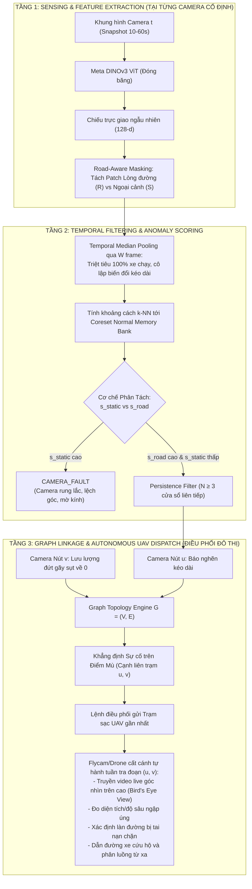

# Hướng 4: Phát Hiện Bất Thường Giao Thông Kéo Dài Trên Đồ Thị & Điều Phối UAV Tuần Tra Tự Hành

> **Đề xuất Tiêu đề Bài báo (Paper Title Candidate):**  
> *Graph-Linked Persistent Traffic Anomaly Detection and Autonomous UAV Inspection for City-Scale Surveillance Networks*  
> **Hội nghị / Tạp chí Mục tiêu:**  
> - **Top-tier Q1:** *IEEE Transactions on Intelligent Transportation Systems (T-ITS)* / *Transportation Research Part C: Emerging Technologies* / *IEEE Transactions on Automation Science and Engineering (T-ASE)*  
> - **Chắc chắn Q2:** *IEEE Access* / *IET Intelligent Transport Systems* / *Journal of Intelligent Transportation Systems*  
> **Lĩnh vực:** Smart Cities, Intelligent Transportation Systems (ITS), Computer Vision, Cyber-Physical Systems (CPS)

---

## 1. TÓM TẮT DỰ ÁN (EXECUTIVE ABSTRACT)

Giám sát và ứng phó sự cố giao thông trên mạng lưới camera CCTV đô thị quy mô lớn (như 600+ camera tại TP.HCM) đối mặt với **3 nút thắt vật lý cốt tử**:
1. **Điểm mù không gian (Spatial Blind Spots):** Camera CCTV gắn cố định chỉ quan sát được phạm vi $50\text{m} - 100\text{m}$ quanh nút giao. Toàn bộ đoạn đường liên trạm dài $500\text{m} - 3\text{km}$ nối giữa hai nút camera hoàn toàn là "vùng mù" thị giác. Khi xảy ra ngập lụt cục bộ, cây đổ, hoặc tai nạn lật xe giữa đoạn nối, trung tâm điều hành (TOC) không thể quan sát được.
2. **Tốc độ lấy mẫu thưa (Temporal Sparsity / Low FPS):** Để truyền tải dữ liệu từ hàng ngàn camera về trung tâm qua mạng 4G/cáp quang, hệ thống chỉ chụp ảnh tĩnh snapshot gián đoạn mỗi $10\text{s} - 60\text{s}$ (hoặc thậm chí 5 phút/lần). Dữ liệu này **hoàn toàn không thể chạy Optical Flow hay Vehicle Tracking liên tục**.
3. **Nghịch lý báo động giả (False Alarm Dilemma):** Các phương pháp học sâu phát hiện bất thường thông thường (Autoencoder, Reconstruction, ST-GNN) bị đánh lừa liên tục bởi: xe dừng chờ đèn đỏ, bóng đổ mây trời, hoặc camera bị rung giật/nước mưa bám kính.

**Hướng 4 (Direction 4)** đề xuất một hệ thống Không-Không Gian Mạng Vật Lý (Cyber-Physical System - CPS) khép kín:
- **Tại từng Camera Nút (Local Node):** Sử dụng **DINOv3 Patch Tokens** (đóng băng) kết hợp **Lọc trung vị theo thời gian (Temporal Feature Median Pooling)** qua cửa sổ $W$ khung hình để **xóa sạch 100% xe cộ di chuyển bình thường**, chỉ giữ lại các biến đổi mặt đường kéo dài (vũng nước ngập, vật cản, xe tai nạn dừng chết máy).
- **Bộ nhớ Chuẩn Mực Phi Tham Số (Coreset Normal Memory Bank):** Lưu trữ các đặc trưng bình thường theo từng khung giờ qua thuật toán K-Center Greedy (PatchCore-style), cho phép phát hiện sự cố theo cơ chế **One-Class Unsupervised** mà không cần bất kỳ nhãn sự cố nào trong quá trình huấn luyện.
- **Phân tách Sự cố vs Lỗi Kỹ thuật Camera (Disentanglement):** Phân tích tương quan giữa điểm bất thường lòng đường ($s_{\text{road}}$) và ngoại cảnh tĩnh ($s_{\text{static}}$) để loại trừ 100% lỗi do camera rung lắc, xoay góc hoặc mờ kính.
- **Suy luận Điểm Mù Trên Đồ Thị & Điều Phối UAV (Graph-Linked UAV Dispatch):** Khi trạm $u$ phát hiện sự cố nghẽn kéo dài và trạm hạ lưu $v$ ghi nhận dòng xe đột ngột đứt gãy, đồ thị mạng lưới đường bộ ($G = (V, E)$) khẳng định sự cố trên cạnh liên kết $(u, v)$ và tự động kích hoạt **Flycam/Drone tự hành** cất cánh tuần tra hành lang $(u, v)$ để truyền video trực tiếp góc nhìn trên cao (Bird's Eye View).

---

## 2. KIẾN TRÚC TỔNG THỂ HỆ THỐNG (END-TO-END CPS ARCHITECTURE)



---

## 3. CHI TIẾT CÁC THUẬT TOÁN CỐT LÕI

### 3.1. Trích Xuất Patch Tokens & Giảm Chiều Bảo Toàn Khoảng Cách (`features.py`)
- **Backbone DINOv3 ViT:** Trích xuất các patch tokens $f_t(p) \in \mathbb{R}^{384}$ với kích thước patch $16 \times 16$. Khác với CLS token (chỉ tóm tắt toàn bộ ảnh), Patch Tokens giữ nguyên tọa độ 2D của từng ô vuông trên mặt đường.
- **Chiếu trực giao ngẫu nhiên (Orthogonal Random Projection):**  
  Áp dụng Bổ đề Johnson-Lindenstrauss: Chiếu từ $384 \to 128$ chiều qua ma trận trực giao $\mathbf{P} \in \mathbb{R}^{384 \times 128}$ ($\mathbf{P}^\top \mathbf{P} = \mathbf{I}$).  
  $$\tilde{f}_t(p) = \mathbf{P}^\top f_t(p), \quad \|\tilde{f}_t(p) - \tilde{f}_t(q)\|_2 \approx \|f_t(p) - f_t(q)\|_2$$
  Giúp giảm **66.7% dung lượng bộ nhớ RAM** mà vẫn bảo toàn trung thực khoảng cách Euclidean phục vụ tìm kiếm láng giềng gần nhất ($k$-NN).

---

### 3.2. Lọc Trung Vị Không Gian Đặc Trưng Theo Thời Gian (`pooling.py`)
Tại sao các thuật toán thông thường thất bại trên camera giao thông? Vì xe cộ chạy liên tục làm đặc trưng thay đổi không ngừng.  
Thay vì lọc trên ảnh RGB, ta thực hiện **Lọc trung vị trên không gian vector đặc trưng DINO** dọc theo trục thời gian qua cửa sổ trượt $W = 5$ khung hình:

$$\tilde{F}_t(p) = \operatorname{median}_{w=0}^{W-1} \tilde{f}_{t-w}(p)$$

#### Cơ chế triệt tiêu phương tiện di chuyển:
- **Xe cộ bình thường:** Di chuyển qua ô patch $p$ trong tối đa 1–2 khung hình snapshot. Trong cửa sổ $W = 5$, đa số các frame ($3/5$) là mặt đường trống. Toán tử `median` **xóa sạch 100% hình ảnh chiếc xe**!
- **Sự cố thực tế (Vũng ngập nước, xe tải chết máy, cây đổ):** Duy trì vị trí cố định qua toàn bộ cửa sổ $W$. Toán tử `median` **giữ nguyên 100% tín hiệu bất thường**!

---

### 3.3. Ngân Hàng Đặc Trưng Bình Thường Coreset K-Center Greedy (`bank.py`)
- **Dữ liệu huấn luyện:** Chỉ sử dụng các ngày giao thông bình thường (không mưa ngập, không sự cố).
- **Phân đoạn theo bối cảnh:** Mỗi camera duy trì các Memory Bank riêng cho 4 khung giờ: Sáng ($6\text{h}-11\text{h}$), Trưa ($11\text{h}-14\text{h}$), Chiều ($14\text{h}-18\text{h}$), và Đêm ($18\text{h}-6\text{h}$).
- **Thuật toán K-Center Greedy (PatchCore-style):** Nén tập hợp hàng trăm ngàn patch đặc trưng bình thường $\mathcal{M}_{\text{all}}$ về tập đại diện $\mathcal{M}_{\text{coreset}}$ với tỷ lệ nén $90\%$:
  $$m^* = \arg\max_{x \in \mathcal{M}_{\text{all}}} \min_{c \in \mathcal{M}_{\text{coreset}}} \|x - c\|_2$$
  Đảm bảo bao phủ toàn bộ phân phối góc chiếu mặt trời và thời tiết bình thường với chi phí RAM cực thấp (**chỉ $2 - 5\text{ MB}$ cho mỗi camera**).

---

### 3.4. Cơ Chế Phân Tách Sự Cố Giao Thông vs Lỗi Kỹ Thuật Camera (`camera_fault.py`, `score.py`)
Tính điểm bất thường cho từng patch $p$ qua khoảng cách Euclidean tới láng giềng gần nhất trong Bank:
$$a_t(p) = \min_{m \in \mathcal{M}_{\text{coreset}}} \|\tilde{F}_t(p) - m\|_2$$

Chia thành 2 vùng thông qua mặt nạ lòng đường (`Road Mask`):
1. **$s_{\text{road}}$:** Điểm bất thường trung bình của top $5\%$ patch cao nhất **trong lòng đường**.
2. **$s_{\text{static}}$:** Điểm bất thường trung bình của top $5\%$ patch cao nhất **ngoài lòng đường** (tòa nhà, cột đèn, vỉa hè).

#### Cây quyết định phân tách sự kiện (Disentanglement Logic):
```
                      [Kiểm tra s_static > tau_static]
                                     │
                    ┌────────────────┴────────────────┐
                   YES                                NO
                    │                                 │
           [CAMERA_FAULT]                 [Kiểm tra s_road > tau_road]
     • Camera bị gió giật xoay góc                    │
     • Mạng nhện / giọt mưa bám ống kính     ┌────────┴────────┐
     • Lỗi cảm biến hình ảnh                YES                NO
     (Tạo ticket bảo trì kỹ thuật)           │                 │
                                    [TRAFFIC_INCIDENT]      [NORMAL]
                                  • Ngập lụt đô thị       Giao thông
                                  • Xe tai nạn chết máy   bình thường
                                  • Vật cản lòng đường
```

---

### 3.5. Bộ Lọc Bền Bỉ Thời Gian & Quản Lý Vòng Đời Sự Kiện (`events.py`)
- **Hiệu chuẩn ngưỡng tự động:** Ngưỡng $\tau_{\text{road}}$ và $\tau_{\text{static}}$ được tính bằng **phân vị 99.5%** của tập điểm bình thường lịch sử.
- **Bộ lọc Persistence:** Để triệt tiêu hoàn toàn báo động giả (False Alarm), sự cố chỉ được xác nhận chính thức khi $s_{\text{road}} > \tau_{\text{road}}$ liên tục trong ít nhất $N$ cửa sổ quan sát liên tiếp ($N \ge 3$, tương đương $15 - 30$ phút).
- **Theo dõi vòng đời:** Ghi nhận 3 mốc thời gian: Thời điểm phát sinh (`Start`), Thời điểm đỉnh điểm (`Peak`), và Thời điểm giải tỏa (`Resolved`).

---

### 3.6. Định Vị Điểm Mù Trên Đồ Thị & Điều Phối UAV Tuần Tra Tự Hành
Mạng lưới 608 camera được mô hình hóa thành Đồ thị có hướng $G = (V, E)$, với $V$ là các nút camera và $E$ là các đoạn đường liên trạm được số hóa từ OpenStreetMap / OSRM.

#### Giải thuật Suy luận Điểm mù Cạnh $(u, v)$:
1. **Camera Nút $u$ (Thượng lưu):** Phát hiện trạng thái `TRAFFIC_INCIDENT` duy trì bền bỉ (dòng xe bị nghẽn không thể tiến lên).
2. **Camera Nút $v$ (Hạ lưu):** Ghi nhận lưu lượng xe $q_v(t)$ đột ngột giảm sâu về xấp xỉ $0$ trong khi lịch sử cùng giờ luôn đông đúc.
3. **Kết luận Đồ thị:** Sự cố nghiêm trọng xảy ra trên **cạnh liên trạm $(u, v)$** (điểm mù camera).
4. **Kích hoạt Drone:**
   - Hệ thống trích xuất danh sách waypoint GPS của đoạn đường $(u, v)$ từ `road_network_distance.csv`.
   - Lập tức truyền tọa độ và kế hoạch bay tới Trạm sạc UAV tự động (UAV Docking Station) gần nhất.
   - UAV cất cánh bay dọc hành lang $(u, v)$, truyền video độ phân giải cao góc nhìn trên cao (Bird's Eye View) về trung tâm TOC.

---

## 4. BẢNG SO SÁNH VỚI CÁC PHƯƠNG PHÁP KHÁC

| Tiêu chí Đánh giá | Classical Background Subtraction | Video Autoencoder / GAN | Spatio-Temporal GNN (STGCN) | **Hướng 4 (Đề xuất)** |
| :--- | :---: | :---: | :---: | :---: |
| **Yêu cầu dữ liệu** | Ảnh liên tục 30 FPS | Cần tập train lớn | Cần nhãn sự cố giám sát | **Chỉ cần ảnh bình thường (One-Class)** |
| **Độ trễ khung hình** | Bắt buộc FPS cao | Cần FPS cao | Nhận chuỗi thời gian | **Hoạt động tốt trên snapshot thưa (10-60s)** |
| **Kháng xe dừng đèn đỏ** | ❌ Kém (Bị lỗi ghosting) | ❌ Kém (Báo động giả) | Trung bình | **✅ Hoàn hảo (Lọc trung vị DINO)** |
| **Kháng lỗi camera** | ❌ Báo động giả 100% | ❌ Báo động giả | ❌ Không phân tách được | **✅ Phân tách rõ ràng (Disentanglement)** |
| **Phạm vi giám sát** | Chỉ trong góc camera | Chỉ trong góc camera | Toàn mạng lưới (không có UAV) | **Định vị điểm mù liên trạm & Điều phối UAV** |
| **Chi phí tính toán** | Thấp | Rất nặng (GPU lớn) | Nặng (Toàn đồ thị) | **Cực nhẹ ($k$-NN Coreset ~ 3ms/frame)** |

---

## 5. KỊCH BẢN THỰC NGHIỆM ĐÁNH GIÁ (EVALUATION BENCHMARK)

1. **Pixel-Level & Image-Level AUROC:** Đánh giá độ chính xác phát hiện và khoanh vùng vị trí sự cố trên tập dữ liệu mô phỏng bán thực tế (`synth_events.py`) gồm các kịch bản: ngập lụt lan rộng, xe lật chắn làn, và camera bị xoay góc.
2. **False Alarm Rate (FAR):** Đo số lần cảnh báo sai trên mỗi camera mỗi ngày trên dữ liệu thật 608 camera TP.HCM (mục tiêu $< 0.5$ lần/camera/ngày).
3. **Detection Latency & Response Time:** Đo thời gian từ khi sự cố bắt đầu đến khi phát hiện và kích hoạt lộ trình bay cho UAV (so sánh với thời gian phát hiện thụ động truyền thống bằng tuần tra xe máy).
